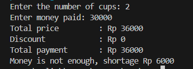
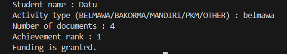

This is my first repository
Name  : Datu Ayu Fitria Caesa
NIM   : 264107020087
Class : 1I-TI

# JOBSHEET 6  - SELECTION STRUCTURES WITH GIT AND GITHUB

**Student Identity:**
* **Name:** Datu Ayu Fitria Caesa
* **Student ID (NIM):** 2641070720087
* **Class / Attendance No.:** 1I / 06

---

## 1: PRACTICUM OBJECTIVES

The objectives of conducting this practicum are:

1. Students are able to solve case studies using basic and nested selection structures 
2. Students are able to save and submit their work using Git and GitHub through Visual Studio Code 
3. Students are able to collaborate with classmates using GitHub

---

## 2: EXPERIMENT RESULTS & ANALYSIS

### 2.1 Experiment 1: Basic Selection

#### 2.1.1 Java Source Code
```java
import java.util.Scanner;

public class StudiKasus106 {
    public static void main(String[] args) {
        Scanner sc = new Scanner(System.in);

        int pricePerCup = 20000;
        int totalCup, moneyPaid;
        int totalPrice, discount, totalPayment;
        int change, shortage;

        System.out.print("Enter the number of cups: ");
        totalCup = sc.nextInt();
        System.out.print("Enter money paid: ");
        moneyPaid = sc.nextInt();

        totalPrice = totalCup * pricePerCup;
        discount = 0;

        if (totalPrice >= 100000) {
            discount = totalPrice * 10 / 100;
        }

        totalPayment = totalPrice - discount;

        System.out.println("Total price         : Rp " + totalPrice);
        System.out.println("Discount            : Rp " + discount);
        System.out.println("Total payment       : Rp " + totalPayment);

        if (moneyPaid >= totalPayment) {
            change = moneyPaid - totalPayment;
            System.out.println("Change              : Rp " + change);
        } else {
            shortage = totalPayment - moneyPaid;
            System.out.println("Money is not enough, shortage Rp " + shortage);
        }
    }
}
```

#### 2.1.2 Execution Results / Output Screenshot
The following is the program output after execution:




---

### 2.2 Experiment 2: Nested Selection

#### 2.2.1 Java Source Code
```java
import java.util.Scanner;

public class StudiKasus206 {
    public static void main(String[] args) {
        Scanner sc = new Scanner(System.in);
        String name, type, status;
        int numDocs, rank, statusFunding, shortage;

        System.out.print("Student name : ");
        name = sc.nextLine();
        System.out.print("Activity type (BELMAWA/BAKORMA/MANDIRI/PKM/OTHER) : ");
        type = sc.nextLine().trim();

        if (type.equalsIgnoreCase("BELMAWA") || 
            type.equalsIgnoreCase("BAKORMA") || 
            type.equalsIgnoreCase("MANDIRI")) {

            System.out.print("Number of documents : ");
            numDocs = sc.nextInt();
            System.out.print("Competition rank : ");
            rank = sc.nextInt();

            if (rank >= 1 && rank <= 3) {
                if (numDocs == 4) {
                    status = "Eligible for award funds.";
                } else {
                    shortage = 4 - numDocs;
                    status = "Documents incomplete (" + shortage + (shortage == 1 ? " document" : " documents") + " missing). No award funds given.";
                }
            } else {
                status = "Not eligible for award funds (only for 1st/2nd/3rd place).";
            }

        } else if (type.equalsIgnoreCase("PKM")) {
            System.out.print("Number of documents : ");
            numDocs = sc.nextInt();
            System.out.print("PKM funding status (1 = approved, 0 = not approved) : ");
            statusFunding = sc.nextInt();

            if (statusFunding == 1) {
                if (numDocs == 4) {
                    status = "Eligible for award funds (PKM proposal approved for funding).";
                } else {
                    shortage = 4 - numDocs;
                    status = "Documents incomplete (" + shortage + (shortage == 1 ? " document" : " documents") + " missing). No award funds given.";
                }
            } else {
                status = "Not eligible for award funds (PKM proposal not approved).";
            }

        } else if (type.equalsIgnoreCase("OTHER") || type.equalsIgnoreCase("LAINNYA")) {
            status = "Not eligible for award funds (activity type not covered by the requirements).";
        } else {
            status = "Invalid activity type.";
        }

        System.out.println("Status : " + status);
    }
}
```

#### 2.2.2 Execution Results / Output Screenshot
The following is the program output after execution:



---
